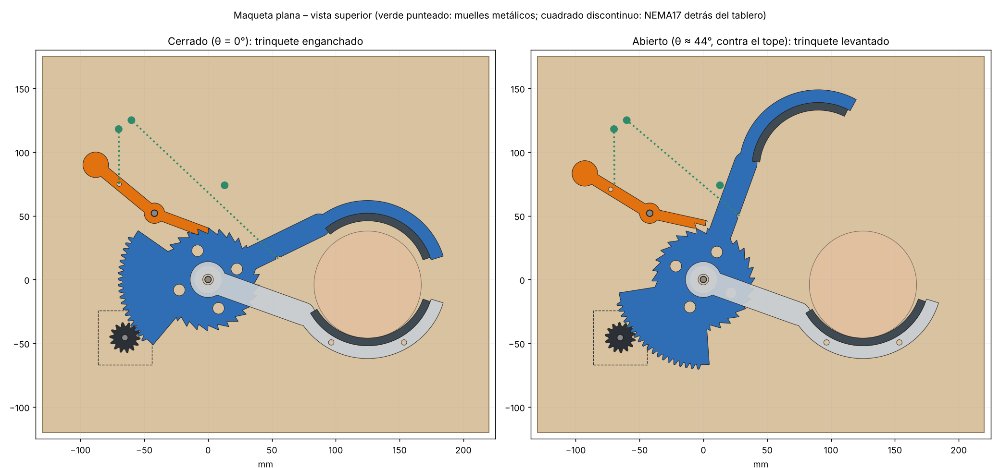

# Maqueta 2D del agarre con carraca (variante 5b)

Maqueta plana del mecanismo de agarre del proyecto **Automatic Adjustable Ratchet Cuff**, pensada para montarse sobre un tablero y comprobar el funcionamiento del mecanismo antes de diseñar el agarre completo para el KUKA LBR iiwa: cierre por motor, retención por carraca, apertura por muelle y *quick release* mecánico.

Es una maqueta de validación, **no el agarre final**. Representa un solo conjunto de palas en sección; el diseño final duplica este conjunto a lo largo del antebrazo sobre el mismo eje.



## Contenido de la carpeta

| Archivo | Qué es |
|---|---|
| `maqueta_carraca.py` | Script paramétrico en CadQuery que genera toda la geometría. Es la fuente de todo lo demás. |
| `maqueta_carraca_5b.step` | Ensamblaje completo, con cada pieza como sólido independiente. Se importa directamente en Onshape. |
| `pala_movil_carraca_sector.stl` | Pala móvil + rueda de carraca + sector dentado, en una sola pieza (a imprimir). |
| `pala_fija.stl` | Pala fija, montada en la capa superior (a imprimir). |
| `trinquete_palanca_QR.stl` | Trinquete y palanca de *quick release*, en una sola pieza (a imprimir). |
| `pinon_stepper.stl` | Piñón para el eje del NEMA 17, con agujero en D de Ø5 mm (a imprimir). |
| `vista_superior.png` | Vista superior en posición cerrada (θ = 0°) y abierta (θ ≈ 44°, contra el tope). |

## Funcionamiento

1. **Cierre:** el motor paso a paso (NEMA 17) mueve el piñón, que engrana con el sector dentado de la pala móvil y la cierra sobre el antebrazo.
2. **Retención:** el trinquete, empujado por su muelle, va saltando por los dientes de la carraca. Deja cerrar y bloquea la apertura, así que la pala queda sujeta sin necesidad de alimentar el motor.
3. **Apertura / quick release:** al tirar de la palanca naranja se levanta el trinquete y el muelle de apertura abre la pala hasta el pin de tope (~44°). Es totalmente mecánico y funciona aunque falle la electrónica.

Como el piñón va directo al eje del stepper (sin rueda libre ni reductora), al abrir la pala arrastra el rotor hacia atrás. Por eso **el driver tiene que deshabilitarse (pin EN) antes de liberar el trinquete**, tanto desde el botón Abrir como desde un microinterruptor en la palanca. Si no, el par de retención del stepper bloquea la apertura.

## Piezas y material

**Impresas (PLA o PETG, 6 mm de espesor):** las cuatro piezas STL.

**Compradas / de taller:**

| Componente | Detalle |
|---|---|
| Motor | NEMA 17, montado detrás del tablero con 4 tornillos M3 |
| Eje del pivote | Ø8 mm |
| Rodamiento | 608 (8 × 22 × 7 mm), en la pala móvil |
| Eje del trinquete | Tornillo de hombro M5 |
| Pines de muelles y tope | Ø4 mm |
| Separadores de la pala fija | 2 uds., con tornillo M4 |
| Muelle de apertura | Muelle de tracción metálico, del brazo de la pala móvil a su pin |
| Muelle del trinquete | Muelle de tracción metálico pequeño, de la palanca a su pin |
| Acolchado | Goma EVA de 6 mm en la cara interior de las palas |
| Tablero | 350 × 295 mm, 10 mm de espesor |
| Antebrazo de prueba | Cilindro de espuma de Ø84 mm (p. ej. churro de piscina) |

Los muelles no están modelados; en el STEP solo aparecen sus pines y agujeros de enganche.

## Datos principales del diseño

- **Capas:** pala móvil, trinquete y piñón en la capa inferior (Z = 1 mm); pala fija encima (Z = 8 mm). Arandelas de 1 mm entre capas.
- **Engranajes:** módulo 1,5, sector de 92 dientes (rueda equivalente) y piñón de 14 dientes. Relación 92/14 ≈ 6,57. Distancia entre ejes 79,5 mm. Juego entre dientes 0,25 mm para impresión.
- **Carraca:** 30 dientes (paso de 12°), 4,5 mm de altura de diente.
- **Recorrido de la pala móvil:** de 0° (cerrada) a ~44° (abierta, contra el tope).

## Cómo regenerar los archivos

Todos los parámetros están al principio de `maqueta_carraca.py`. Para cambiar algo (número de dientes, holguras, posiciones, espesor), edítalo y vuelve a ejecutar:

```bash
pip install cadquery
python maqueta_carraca.py <carpeta_de_salida>
```

Genera de nuevo el `.step` y los cuatro `.stl`.

## Montaje en Onshape

1. Importa `maqueta_carraca_5b.step` (cada pieza llega como sólido independiente).
2. En un Assembly, fija el tablero y la pala fija.
3. Añade *revolute mates* en el pivote (pala móvil), en el eje del trinquete y en el eje del stepper (piñón).
4. Añade una *gear relation* entre piñón y pala móvil con relación 92/14.
5. Comprueba que el piñón engrana con el sector y que la pala recorre de 0° hasta el tope.

## Notas para imprimir y montar

- Los agujeros suelen salir algo pequeños al imprimir: repasa el del rodamiento 608 (Ø22) y el del eje en D (Ø5).
- Fija el piñón al eje del NEMA a la altura del sector (prisionero o pegamento): el eje no tiene tope.
- Si los engranajes rozan, lija un poco o aumenta `BACKLASH` en el script.
- Comprueba que el muelle del trinquete basta para que la punta caiga en cada diente, y que el de apertura vence el par de enclavamiento del stepper sin alimentar más el rozamiento de los engranajes.
- Recomendación: imprime primero solo la pala móvil y el trinquete, y prueba en el tablero que la carraca retiene y suelta bien antes de imprimir el resto.

## Problema conocido (pendiente)

Con 30 dientes, el trinquete solo engancha cada 12°. Al cerrar sobre el antebrazo, la posición de apriete objetivo puede quedar lejos del diente más cercano, y entonces la retención mecánica (sin el par del stepper) queda prácticamente sin fuerza. Opciones para resolverlo antes de la versión definitiva:

- Aumentar el número de dientes de la carraca (por ejemplo a 60, paso de 6°), cambiando `NT` en el script.
- Usar dos trinquetes desfasados medio diente.
